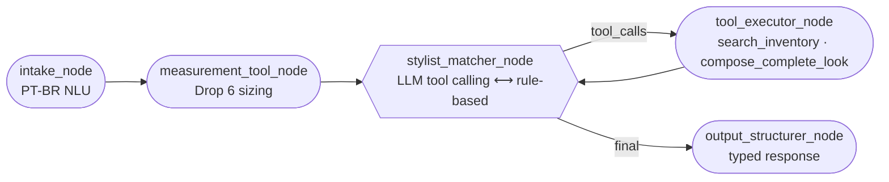

# Tailor AI Engine

[](https://github.com/TeuszMAN/tailor-ai-stylist-engine/actions/workflows/ci.yml)

**White-label agentic menswear stylist** — FastAPI · LangGraph · Pydantic v2 · Python 3.11+

> 🇬🇧 English first · 🇧🇷 [Versão em português abaixo](#-português)

A production-minded microservice that turns *"I'm the best man at an afternoon wedding"* into **complete,
etiquette-validated outfits** (suit + shirt + tie + shoes) built **only from pieces in stock in the customer's size**,
plus an anthropometric **size passport** (suit 46–60, pants 38–54, shirt 1–6, Slim/Regular cut).

It runs **with zero API keys**: a deterministic rule-based planner speaks the *same tool-calling protocol* as the LLM,
so recruiters and clients can test the full agentic flow right after `git clone`. Add an Anthropic or OpenAI key and
the same graph gains LLM reasoning — with a **self-healing fallback** if the provider fails.



## Highlights

| | |
|---|---|
| 🧠 **LangGraph `StateGraph`** | Typed Pydantic state, explicit reducers, a tool-calling loop and a node-level fallback that switches `llm → rule_based` on errors or invalid outcomes. |
| 🧰 **Deterministic tools** | `calculate_tailoring_size`, `search_inventory` (lexical-semantic, PT-BR synonyms), `compose_complete_look` (classic etiquette rules **as data**). |
| 🛡️ **Guardrails** | The executor injects the customer's size when the LLM forgets it; the output node drops anything not in stock in that size. |
| 🏷️ **White-label** | Catalog from the request payload, a JSON file, SQLite or the bundled generic demo. No store names, phone numbers or secrets in this repo. |
| 🔍 **Observability** | Every response carries `engine.graph_path`, per-tool traces (args, duration, ok) and `fallback_reason`. |
| 📐 **Contracts & parity** | OpenAPI + JSON Schemas + Mermaid exported from code; golden **parity vectors** let other runtimes (e.g. a TypeScript fallback) reproduce the engine bit-for-bit. |
| 🔒 **Safe to expose** | Per-client rate limits (429 + `Retry-After`), request size limit (413), CORS restricted by default and a global LLM budget that degrades to rule-based instead of failing. |
| ✅ **Quality gates** | GitHub Actions on Python 3.11–3.13: `mypy --strict`, `ruff`, 103 tests (incl. a scripted chat model for the LLM path) and a Docker smoke test. |

## Quickstart

```bash
git clone https://github.com/TeuszMAN/tailor-ai-stylist-engine tailor-ai-engine && cd tailor-ai-engine
python3 -m venv .venv && . .venv/bin/activate
pip install -r requirements-dev.txt
uvicorn app.main:app --reload --port 8000
```

Open <http://localhost:8000/docs>, or call it directly:

```bash
curl -s -X POST localhost:8000/api/v1/fit-finder -H 'content-type: application/json' \
  -d '{"height_cm":180,"weight_kg":85,"chest_type":"medio","belly_type":"medio"}'
# -> "summary": "Terno 52 Regular | Calça 46 | Camisa 4 (G)"

curl -s -X POST localhost:8000/api/v1/stylist/recommend -H 'content-type: application/json' \
  -d '{"message":"Sou padrinho de casamento à tarde, tenho 1,80 m e 85 kg"}'
```

**Docker**

```bash
docker build -t tailor-ai-engine .
docker run -p 8000:8000 --env-file .env tailor-ai-engine
```

**LLM mode (optional)** — copy `.env.example` to `.env` and set `ANTHROPIC_API_KEY` (default model `claude-opus-5-5`)
or `OPENAI_API_KEY`. `GET /health` reports `llm_mode`.

**Deploying publicly** — set `CORS_ALLOW_ORIGINS` to your storefront URL (the default only allows
`http://localhost:3000`), keep `RATE_LIMIT_ENABLED=true`, tune `LLM_MAX_REQUESTS_PER_MINUTE` to your budget and,
behind a reverse proxy, set `FORWARDED_ALLOW_IPS` so limits see real client IPs. Limits are per process: with several
replicas, enforce global limits at the gateway.

## API

| Method | Route | Purpose |
|---|---|---|
| `GET` | `/health` | Service, mode (`llm`/`rule_based`), catalog source and size |
| `POST` | `/api/v1/fit-finder` | Anthropometric sizing (Drop 6 algorithm) |
| `POST` | `/api/v1/stylist/recommend` | Agentic stylist: reply + validated looks + suggestions + trace |
| `GET` | `/api/v1/catalog` | Configured catalog with filters |
| `POST` | `/api/v1/inventory/search` | Semantic search over the configured or a payload catalog |
| `POST` | `/api/v1/looks/compose` | Mix & Match: validate any suit/shirt/tie/shoes combination |

Send your own catalog to stay white-label: `{"message": "...", "catalog": [Product, ...]}` (up to 500 products).
Full contract: [`docs/contracts/openapi.json`](docs/contracts/openapi.json) · design: [`docs/SDD.md`](docs/SDD.md).

## The Drop 6 sizing algorithm (short version)

`effective weight = weight − 0.4 × (height − 175)` → base size band (46…60) → jacket `+2` for a broad chest or large belly
→ pants = jacket − drop (biotype matrix: athletic 8, neutral **6**, large belly 4) → shirt `(jacket − 46)/2 + 1`
→ Slim/Regular from biotype and BMI. Everything is integer math, so ports are exact. Spec and tables: SDD §5.

## Project layout

```
app/
  schemas.py          Pydantic v2 contracts (source of the OpenAPI document)
  main.py             FastAPI routes, CORS, lifespan
  security.py         HTTP guards: rate limiting (429) and request size limit (413)
  ratelimit.py        framework-free sliding-window limiter (also the global LLM budget)
  config.py           12-factor settings (pydantic-settings)
  tools/              sizing.py · inventory.py · harmony.py · harmony_rules.json · vocabulary.py
  catalog/            repository.py (demo | file | sqlite | payload) · mock_catalog.json
  agent/              state.py · intake.py · planner.py · llm.py · prompts.py · formatter.py · graph.py
scripts/              export_contracts.py · generate_parity_vectors.py · seed_sqlite.py
tests/                103 tests (unit, graph, API, security, contract drift)
docs/                 SDD.md · TASK_BOARD.md · contracts/ (OpenAPI, JSON Schemas, Mermaid, parity vectors)
.github/workflows/    ci.yml (Python 3.11–3.13 quality gates + Docker smoke test)
```

## Development

```bash
ruff check app tests scripts && ruff format --check app tests scripts
mypy app scripts
pytest
python -m scripts.export_contracts && python -m scripts.generate_parity_vectors   # after contract/rule changes
```

Multi-agent governance (Claude Code, Antigravity, OpenCode, Hermes): see [`AGENTS.md`](AGENTS.md) and
[`docs/TASK_BOARD.md`](docs/TASK_BOARD.md).

---

## 🇧🇷 Português

**Motor agêntico white-label de consultoria de moda masculina clássica** com FastAPI, LangGraph e Pydantic v2.

O serviço transforma *"Sou padrinho de casamento à tarde"* em **looks completos** (terno + camisa + gravata + sapato)
validados pela etiqueta clássica, usando **somente peças em estoque no tamanho do cliente**, e calcula o
**Passaporte de Medidas** (terno 46–60, calça 38–54, camisa 1–6, corte Slim/Regular).

### Por que é diferente

* **Funciona sem API key:** o *Deterministic Rule-Based Fallback* usa o mesmo protocolo de tool calling do LLM —
  mesmo grafo, mesmo *trace*, mesma resposta tipada. Com chave Anthropic/OpenAI, o LLM assume o planejamento e,
  se falhar, o grafo **se recupera sozinho** (`fallback_reason` explica o motivo).
* **Tools determinísticas e auditáveis:** cálculo antropométrico em aritmética inteira, busca léxico-semântica com
  sinônimos PT-BR ("vinho" → bordô, "chumbo" → cinza-chumbo) e motor de harmonia com regras **em JSON**.
* **White-label e público:** nenhum dado de loja real; o catálogo chega por payload, arquivo, SQLite ou demo genérico.
* **Contratos vivos:** OpenAPI, JSON Schemas, diagrama Mermaid do grafo compilado e vetores de paridade são gerados
  do código e verificados em teste.

### Como rodar

```bash
python3 -m venv .venv && . .venv/bin/activate
pip install -r requirements-dev.txt
uvicorn app.main:app --reload --port 8000      # docs em http://localhost:8000/docs
pytest                                         # 103 testes
```

Variáveis de ambiente: veja [`.env.example`](.env.example) e o SDD §9. Documentação completa de arquitetura,
algoritmo Drop 6, regras de harmonia e contrato de API: [`docs/SDD.md`](docs/SDD.md).

## License

MIT — see [`LICENSE`](LICENSE). Product photos in the demo catalog are referenced from Unsplash (Unsplash License).
