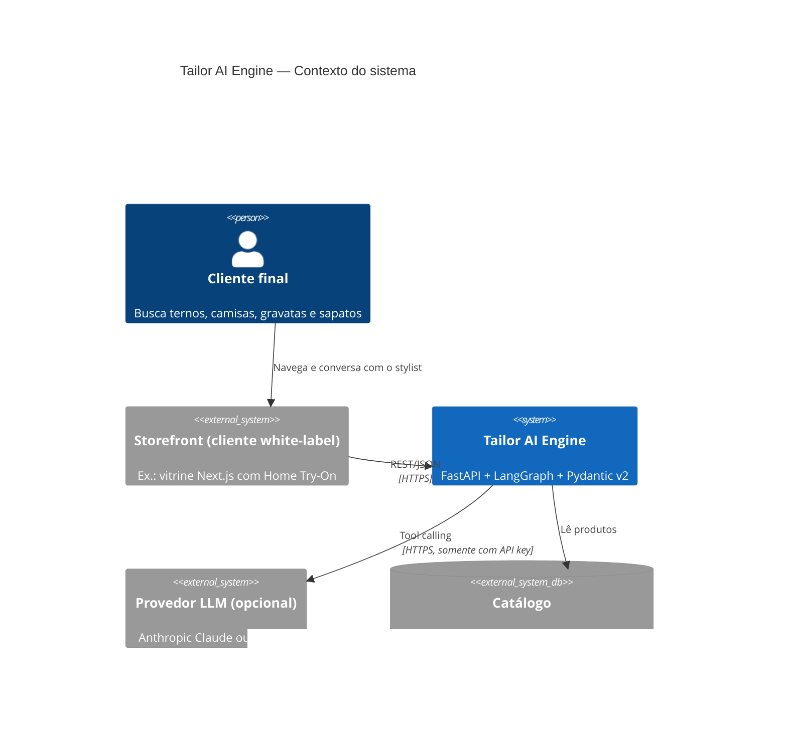
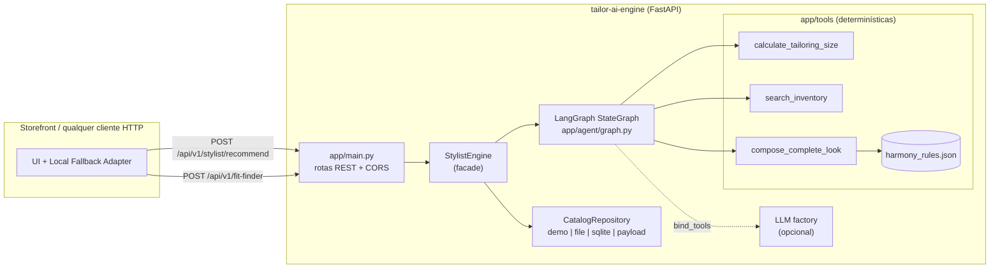
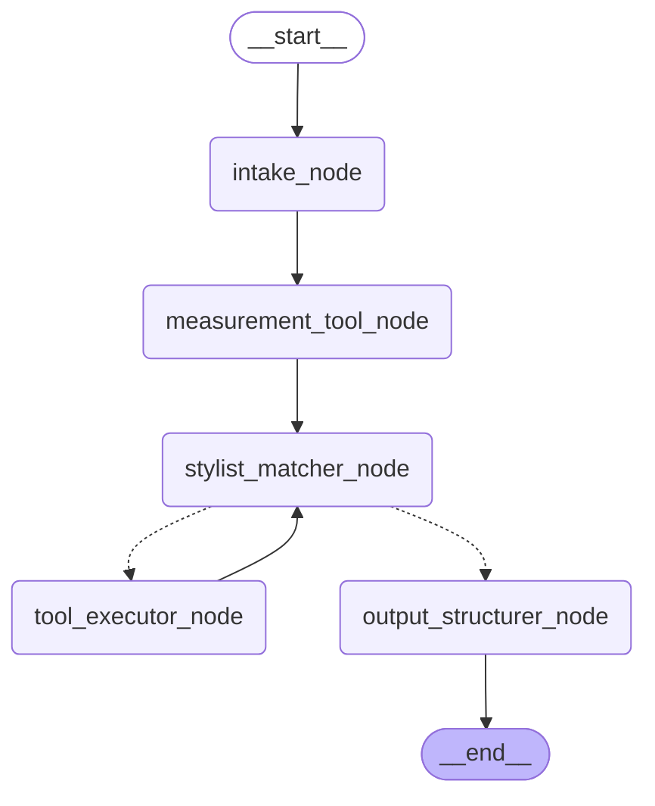
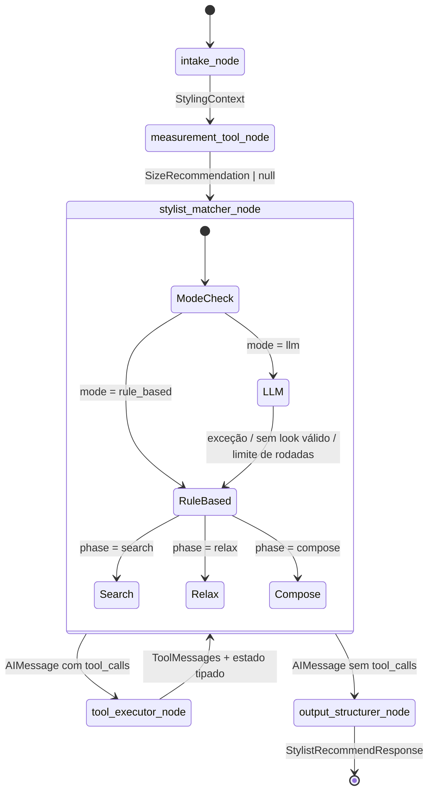
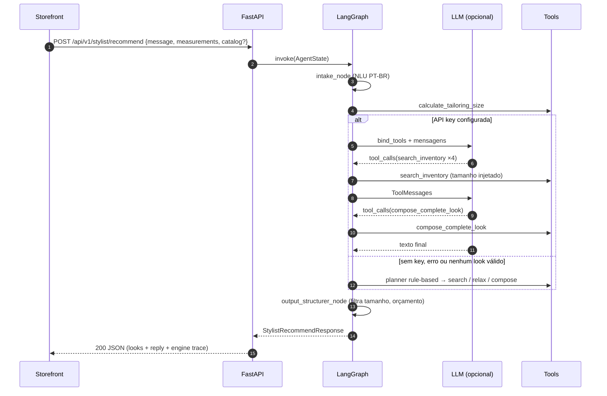

# SDD — Tailor AI Engine

> **Software Design Document** · versão 1.0.0 · algoritmo `drop6-v1` · ruleset `classic-etiquette-v1`
> Repositório **público** (portfólio de AI Engineering). Nenhum nome de loja, telefone ou dado sensível
> pertence a este repositório: tudo que é específico de negócio entra por variável de ambiente ou payload.

## Sumário

1. [Visão e escopo](#1-visão-e-escopo)
2. [Arquitetura (C4)](#2-arquitetura-c4)
3. [Grafo de estados LangGraph](#3-grafo-de-estados-langgraph)
4. [Tools determinísticas](#4-tools-determinísticas)
5. [Especificação do algoritmo Drop 6](#5-especificação-do-algoritmo-drop-6)
6. [Motor de harmonia (etiqueta clássica)](#6-motor-de-harmonia-etiqueta-clássica)
7. [Intake NLU e planner rule-based](#7-intake-nlu-e-planner-rule-based)
8. [Contrato de API (OpenAPI / JSON)](#8-contrato-de-api-openapi--json)
9. [Configuração](#9-configuração)
10. [Qualidade, paridade e observabilidade](#10-qualidade-paridade-e-observabilidade)
11. [Decisões de arquitetura (ADRs)](#11-decisões-de-arquitetura-adrs)
12. [Riscos e evolução](#12-riscos-e-evolução)

---

## 1. Visão e escopo

O **Tailor AI Engine** é um microsserviço *white-label* de consultoria de moda masculina clássica.
Ele recebe a mensagem de um cliente ("Sou padrinho de casamento à tarde"), suas medidas e,
opcionalmente, o catálogo da loja, e devolve:

* o **Passaporte de Medidas** (terno 46–60, calça 38–54, camisa 1–6, corte Slim/Regular);
* **looks completos** (terno + camisa + gravata + sapato) validados pela etiqueta clássica,
  apenas com peças **em estoque no tamanho do cliente**;
* texto consultivo, sugestões complementares e um *trace* auditável de cada tool call.

| Objetivo | Como |
|---|---|
| Funcionar com custo zero logo após `git clone` | *Deterministic Rule-Based Fallback* com o mesmo protocolo de tool calling do LLM |
| Nunca recomendar o que não existe / não serve | Tools determinísticas + guardrails no executor + filtro final por tamanho |
| White-label | Catálogo por payload, arquivo JSON, SQLite ou demo; marca e canais ficam no cliente |
| Auditabilidade | `engine.graph_path` + `engine.tool_calls[]` em toda resposta |
| Portabilidade | Regras como **dados** (`harmony_rules.json`) + *parity vectors* para portes (ex.: TypeScript) |

**Fora de escopo:** pagamentos, checkout, CRM, autenticação de usuários finais (responsabilidade do storefront).

## 2. Arquitetura (C4)

### 2.1 Contexto (C4 nível 1)



### 2.2 Contêineres e componentes (C4 níveis 2–3)



| Módulo | Responsabilidade |
|---|---|
| `app/schemas.py` | Contratos Pydantic v2 (fonte da verdade do OpenAPI) |
| `app/tools/` | `sizing.py`, `inventory.py`, `harmony.py` + vocabulário PT-BR |
| `app/catalog/` | Repository pattern (JSON, SQLite, payload) + `mock_catalog.json` genérico |
| `app/agent/` | `state.py`, `intake.py`, `planner.py`, `llm.py`, `prompts.py`, `formatter.py`, `graph.py` |
| `scripts/` | Export de contratos, *parity vectors*, seed SQLite |

## 3. Grafo de estados LangGraph

### 3.1 Diagrama gerado do grafo compilado

Gerado por `StylistEngine.mermaid()` (arquivo: [`docs/contracts/langgraph.mmd`](contracts/langgraph.mmd)):



### 3.2 Máquina de estados com o fallback auto-curável



| Nó | Entrada → Saída | Detalhes |
|---|---|---|
| `intake_node` | `request` → `context` | NLU determinística PT-BR (ocasião, horário, papel, dress code, cores por categoria, orçamento, medidas em texto). |
| `measurement_tool_node` | `request.measurements` / medidas do texto → `size_profile` | Chama `calculate_tailoring_size` e registra o *trace*. Sem medidas → segue sem filtro de tamanho. |
| `stylist_matcher_node` | estado → `AIMessage` | **LLM** (`bind_tools`) ou **Rule-Based planner** (mesmo protocolo). Auto-cura: qualquer erro do LLM, ou LLM que termina sem look válido, troca `mode` para `rule_based` e grava `fallback_reason`. |
| `tool_executor_node` | `tool_calls` → `ToolMessage[]`, `inventory`, `looks`, `tool_traces` | Valida args com Pydantic, **injeta o tamanho do cliente** quando o LLM omite, captura erros como resultado da tool. |
| `output_structurer_node` | estado → `response` | Deduplica, remove looks inválidos/fora de estoque no tamanho, aplica alerta de orçamento, monta texto, sugestões e *quick replies*. |

### 3.3 `AgentState` (Pydantic v2) e reducers

| Campo | Tipo | Reducer |
|---|---|---|
| `request`, `catalog`, `catalog_source` | entrada imutável | último valor |
| `mode`, `provider`, `model`, `fallback_reason` | modo do motor | último valor |
| `context`, `measurements`, `size_profile` | resultados determinísticos | último valor |
| `messages` | `list[AnyMessage]` | `add_messages` |
| `inventory` | `dict[category, list[Product]]` | `merge_inventory` (dedupe por id, ordem preservada) |
| `looks`, `tool_traces`, `graph_path` | listas | `operator.add` |
| `planner_phase` | `search → relax → compose → done` | último valor |
| `response` | `StylistRecommendResponse` | último valor |

`recursion_limit = 40`; `LLM_MAX_TOOL_ROUNDS = 4` (rodadas de tool calling antes do corte).

## 4. Tools determinísticas

| Tool | Assinatura | Garantias |
|---|---|---|
| `calculate_tailoring_size` | `(height_cm, weight_kg, chest_type, belly_type, shoe_size=None) -> SizeRecommendation` | Aritmética inteira; entradas validadas (150–210 cm, 45–160 kg). |
| `search_inventory` | `(category, size, formality, color_query, query=None, *, catalog, in_stock_only=True, limit=20) -> InventorySearchResult` | Só retorna peças com o tamanho **em estoque**; sinônimos de cor ("vinho" → `burgundy`), inferência de categoria ("mocassim" → `shoes`), ranking léxico-semântico. |
| `compose_complete_look` | `(suit_id, shirt_id, tie_id, shoe_id, target_formality=None, time_of_day=None, *, catalog) -> OutfitRecommendation` | Valida categorias, aplica `harmony_rules.json`, calcula preço total e justificativa. |

**Ranking do `search_inventory`:** `score = 3·|termos ∩ campos fortes| + 1·|termos ∩ campos fracos| + 2·ocasiões + 2·formalidades`,
com campos fortes = nome, cor, sinônimos da família de cor e da categoria; fracos = descrição, tecido, estilo, rótulos de ocasião e formalidade.
Termos passam por normalização (minúsculas, sem acentos) e *stemming* leve (remove `s` final em palavras com mais de 3 letras).
Com texto livre, produtos com score 0 são descartados, exceto quando a própria consulta gerou um filtro de categoria/cor.

## 5. Especificação do algoritmo Drop 6

Algoritmo **`drop6-v1`** — determinístico, sem ponto flutuante nas decisões (valores ×10).

### 5.1 Entradas

| Campo | Domínio |
|---|---|
| `height_cm` | inteiro 150–210 |
| `weight_kg` | inteiro 45–160 |
| `chest_type` (tórax) | `atletico` · `medio` · `largo` |
| `belly_type` (abdômen) | `atletico` · `medio` · `largo` |
| `shoe_size` | opcional, 37–46 (repassado) |

### 5.2 Passos

1. **Peso efetivo** (ajuste à altura de referência de 175 cm, 0,4 kg/cm):
   `eff×10 = 10·peso − 4·(altura − 175)`
2. **Tamanho base** pelas faixas de peso efetivo:

   | Peso efetivo (kg) | ≤ 62,0 | ≤ 69,0 | ≤ 76,0 | ≤ 84,0 | ≤ 92,0 | ≤ 101,0 | ≤ 111,0 | > 111,0 |
   |---|---|---|---|---|---|---|---|---|
   | **Base (terno)** | 46 | 48 | 50 | 52 | 54 | 56 | 58 | 60 |

3. **Paletó (terno):** `paletó = base + 2` se tórax **largo** *ou* abdômen **largo** (folga no peito / fechamento sobre o abdômen); senão `base`. Limite 46–60.
4. **Drop** (paletó − calça) pela matriz de biotipo:

   | Tórax \ Abdômen | Atlético | Médio | Largo |
   |---|---|---|---|
   | **Atlético** | 8 | 8 | 6 |
   | **Médio** | 8 | **6** (neutro) | 4 |
   | **Largo** | 8 | 6 | 4 |

   `calça = paletó − drop`, limitada a 38–54. O campo `drop` da resposta é recalculado após os limites.
5. **Corte** (`bmi×10 = round_half_up(peso·100000 / altura²)`), primeira regra que casar:
   1. abdômen largo → **Regular**
   2. IMC ≥ 28,0 → **Regular**
   3. tórax atlético ou abdômen atlético → **Slim**
   4. IMC < 22,0 → **Slim**
   5. caso contrário → **Regular**
6. **Camisa:** `camisa = clamp((paletó − 46) / 2 + 1, 1, 6)`

   | Camisa | 1 | 2 | 3 | 4 | 5 | 6 |
   |---|---|---|---|---|---|---|
   | Letra | PP | P | M | G | GG | XG |
   | Colarinho (cm) | 37 | 38 | 39–40 | 41–42 | 43–44 | 45–46 |

7. **Comprimento do paletó:** < 170 cm → `curto`; 170–184 → `regular`; ≥ 185 → `longo`.
8. **Estimativas:** tórax ≈ `paletó × 2` cm; cintura ≈ `calça × 2` cm (convenção da grade brasileira).

### 5.3 Exemplo trabalhado

180 cm, 85 kg, tórax médio, abdômen médio → `eff = 85 − 0,4·5 = 83,0 kg` → base **52** → paletó 52 → Drop 6 → calça **46**
→ IMC 26,2 → **Regular** → camisa **4 (G)** → **`Terno 52 Regular | Calça 46 | Camisa 4 (G)`**.

### 5.4 Tabela de referência (tórax e abdômen médios)

Formato: `terno / calça / camisa` + corte (S = Slim, R = Regular).

| Altura \ Peso | 60 kg | 70 kg | 80 kg | 90 kg | 100 kg | 110 kg |
|---|---|---|---|---|---|---|
| 160 cm | 48 / 42 / 2 R | 50 / 44 / 3 R | 54 / 48 / 5 R | 56 / 50 / 6 R | 58 / 52 / 6 R | 60 / 54 / 6 R |
| 170 cm | 46 / 40 / 1 S | 50 / 44 / 3 R | 52 / 46 / 4 R | 54 / 48 / 5 R | 58 / 52 / 6 R | 60 / 54 / 6 R |
| 175 cm | 46 / 40 / 1 S | 50 / 44 / 3 R | 52 / 46 / 4 R | 54 / 48 / 5 R | 56 / 50 / 6 R | 58 / 52 / 6 R |
| 180 cm | 46 / 40 / 1 S | 48 / 42 / 2 S | 52 / 46 / 4 R | 54 / 48 / 5 R | 56 / 50 / 6 R | 58 / 52 / 6 R |
| 185 cm | 46 / 40 / 1 S | 48 / 42 / 2 S | 50 / 44 / 3 R | 54 / 48 / 5 R | 56 / 50 / 6 R | 58 / 52 / 6 R |
| 190 cm | 46 / 40 / 1 S | 48 / 42 / 2 S | 50 / 44 / 3 R | 52 / 46 / 4 R | 56 / 50 / 6 R | 58 / 52 / 6 R |

### 5.5 Efeito do biotipo (180 cm · 85 kg)

| Tórax \ Abdômen | Atlético | Médio | Largo |
|---|---|---|---|
| **Atlético** | 52 / 44 (Drop 8) · 4 · Slim | 52 / 44 (Drop 8) · 4 · Slim | 54 / 48 (Drop 6) · 5 · Regular |
| **Médio** | 52 / 44 (Drop 8) · 4 · Slim | 52 / 46 (Drop 6) · 4 · Regular | 54 / 50 (Drop 4) · 5 · Regular |
| **Largo** | 54 / 46 (Drop 8) · 5 · Slim | 54 / 48 (Drop 6) · 5 · Regular | 54 / 50 (Drop 4) · 5 · Regular |

Grade completa validada em teste (`tests/test_sizing.py::test_full_grid_always_produces_valid_sizes`) e em
[`docs/contracts/parity/drop6_vectors.json`](contracts/parity/drop6_vectors.json) (378 casos).

## 6. Motor de harmonia (etiqueta clássica)

Fonte: [`app/tools/harmony_rules.json`](../app/tools/harmony_rules.json) — **regras são dados**.

```
score = 60
      + Σ pontos(rating) dos 4 pares (terno×sapato, terno×camisa, terno×gravata, camisa×gravata)
      + 8 (bônus de formalidade alinhada)
      − 10 por alerta de contexto · − 30 por violação de contexto
score ∈ [0, 100] · is_valid = nenhuma violação (inclui pares "forbidden")
```

**Terno × Sapato** (`suit_shoes`)

| | black | brown | cognac |
|---|---|---|---|
| **navy** | ★ +8 | ★ +8 | ✓ +4 |
| **charcoal** | ★ +8 | · 0 | ⚠ −10 |
| **grey** | ★ +8 | ★ +8 | ✓ +4 |
| **sand** | ✗ −30 | ★ +8 | ★ +8 |
| **black** | ★ +8 | ✗ −30 | ✗ −30 |

**Terno × Camisa** (`suit_shirt`)

| | white | light_blue | blue_stripe | pink |
|---|---|---|---|---|
| **navy** | ★ +8 | ★ +8 | ✓ +4 | ★ +8 |
| **charcoal** | ★ +8 | ★ +8 | ✓ +4 | ✓ +4 |
| **grey** | ★ +8 | ★ +8 | ✓ +4 | ★ +8 |
| **sand** | ★ +8 | ★ +8 | · 0 | ✓ +4 |
| **black** | ★ +8 | ⚠ −10 | ⚠ −10 | ⚠ −10 |

**Terno × Gravata** (`suit_tie`)

| | burgundy | navy | silver | emerald | lavender |
|---|---|---|---|---|---|
| **navy** | ★ +8 | ⚠ −10 | ✓ +4 | ★ +8 | ✓ +4 |
| **charcoal** | ★ +8 | ✓ +4 | ★ +8 | ✓ +4 | ✓ +4 |
| **grey** | ★ +8 | ★ +8 | ✓ +4 | ✓ +4 | ★ +8 |
| **sand** | ✓ +4 | ★ +8 | ✓ +4 | ★ +8 | ★ +8 |
| **black** | ✓ +4 | ✓ +4 | ★ +8 | · 0 | ⚠ −10 |

**Camisa × Gravata** (`shirt_tie`)

| | burgundy | navy | silver | emerald | lavender |
|---|---|---|---|---|---|
| **white** | ★ +8 | ★ +8 | ★ +8 | ★ +8 | ✓ +4 |
| **light_blue** | ★ +8 | ★ +8 | ✓ +4 | ✓ +4 | · 0 |
| **blue_stripe** | ★ +8 | ✓ +4 | · 0 | ✓ +4 | ⚠ −10 |
| **pink** | ✓ +4 | ★ +8 | ✓ +4 | · 0 | ⚠ −10 |

Pares fora das matrizes valem `acceptable` (0), o que permite catálogos com outras famílias de cor.

**Regras de contexto**

| Regra | Condição | Severidade |
|---|---|---|
| `black_tie_suit` / `_shirt` / `_shoes` | dress code black tie sem terno de cerimônia, camisa branca ou oxford preto | violação |
| `formality_below_many` | formalidade do look ≥ 2 degraus abaixo do alvo | violação |
| `formality_below_one` | 1 degrau abaixo | alerta |
| `formality_above` | ≥ 2 degraus acima | alerta |
| `night_light_suit` | noite + terno bege-areia | alerta |
| `night_brown_shoes` | noite + sapato café/conhaque ("no brown after six") | alerta |
| `day_black_suit` | dia/tarde + terno preto | alerta |
| `pattern_clash_shirt_tie` | camisa listrada/xadrez + gravata estampada | alerta |
| `pattern_clash_suit_shirt` | terno xadrez + camisa estampada | alerta |

**Formalidade do look** = menor "formalidade máxima" entre as 4 peças (`smart_casual=1 … black_tie=4`).
**Nome do look** = `"{prefixo} {cor do terno} · Gravata {cor da gravata}"`, com prefixo pelo dress code
(`Esporte Fino`, `Executivo`, `Cerimônia`, `Gala`). **`look_id`** = `look-` + FNV-1a 32 bits de `suit|shirt|tie|shoes`.

## 7. Intake NLU e planner rule-based

### 7.1 Intake (determinístico)

* **Normalização:** minúsculas, NFD sem diacríticos, mantém `[a-z0-9$,.]`.
* **Correspondência de frases:** maior frase primeiro, com *spans* consumidos ("azul celeste" impede "azul").
* **Prioridade de ocasião:** `casamento > formatura > entrevista > gala > versatil > evento_diurno > trabalho` (padrão: `versatil`).
* **Dress code:** palavras-chave (`black tie`, `passeio completo`, `esporte fino`, `traje social`) sobrepõem o padrão da ocasião.
* **Cores por categoria:** a pista mais próxima ("gravata verde", "sapato marrom") atribui a cor à categoria; sem pista → terno.
  Negação (`sem`, `não`, `nada de`, `evitar`…) move a cor para `avoid` **da mesma categoria**.
* **Medidas no texto:** `1,80 m` / `180 cm`, `85 kg`, `calço 42`, "barriga", "ombros largos", "atlético".
* **Histórico:** a mensagem atual vence; turnos anteriores do usuário preenchem lacunas ("E se for à noite?").

### 7.2 Paleta padrão de ternos

| Ocasião | Padrão | Ajustes |
|---|---|---|
| casamento (dia / tarde / noite) | sand, grey, navy / sand, navy, grey / navy, charcoal, black | noite remove `sand`; dia/tarde remove `black` |
| formatura | black, navy, charcoal | verão (sem ser noite) antecipa `sand` |
| entrevista | navy, charcoal | inverno remove `sand` |
| trabalho · versátil | navy, charcoal, grey | black tie → somente `black` |
| evento diurno | sand, grey, navy | |

### 7.3 Planner rule-based (fallback sem API key)

1. **search:** `search_inventory` para terno, camisa, gravata e sapato no tamanho do cliente e dress code alvo (+ calça para versatilidade/trabalho).
2. **relax:** categorias vazias são buscadas de novo **sem** filtro de formalidade (o tamanho nunca é relaxado).
3. **compose:** ternos ranqueados (`30/20/10` pela posição na paleta, `+10` dress code, `±5` estação); a paleta tem prioridade
   e outras cores só entram se ela estiver sem estoque. Para cada terno do plano, busca exaustiva de camisa × gravata × sapato válida que maximiza
   `harmony_score − 4·reuso + 12·cor pedida − 25·acima do orçamento` (desempate: menor preço, depois ids).
   Pedido versátil → **um terno, três maneiras**.
4. **done:** a resposta é estruturada por `output_structurer_node`.

## 8. Contrato de API (OpenAPI / JSON)

Contrato completo e versionado: [`docs/contracts/openapi.json`](contracts/openapi.json) e JSON Schemas em
[`docs/contracts/schemas/`](contracts/schemas/). O teste `tests/test_contracts.py` falha se o código divergir dos arquivos exportados.

| Método | Rota | Request | Response |
|---|---|---|---|
| `GET` | `/health` | — | `HealthResponse` |
| `POST` | `/api/v1/fit-finder` | `UserMeasurements` | `SizeRecommendation` |
| `POST` | `/api/v1/stylist/recommend` | `StylistRecommendRequest` | `StylistRecommendResponse` |
| `GET` | `/api/v1/catalog` | query: `category`, `size`, `formality`, `color`, `q`, `in_stock_only` | `CatalogResponse` |
| `POST` | `/api/v1/inventory/search` | `InventorySearchRequest` | `InventorySearchResult` |
| `POST` | `/api/v1/looks/compose` | `ComposeLookRequest` | `OutfitRecommendation` (422 = combinação inválida) |

Erros: `422` com `{"detail": "..."}` (regra de negócio) ou o formato de validação padrão do FastAPI;
`413` (corpo grande demais) e `429` (limite atingido, com `Retry-After`) com `{"detail": "..."}` — ver §9.1.
Dinheiro sempre em **centavos inteiros** (`price_cents`, `total_price_cents`, `budget_max_cents`).

### 8.1 `POST /api/v1/fit-finder`

```json
{ "height_cm": 180, "weight_kg": 85, "chest_type": "medio", "belly_type": "medio", "shoe_size": 41 }
```

```json
{
  "suit_size": 52, "pants_size": 46, "shirt_size": 4, "shirt_letter": "G", "collar_cm": "41-42",
  "fit": "regular", "drop": 6, "jacket_length": "regular", "shoe_size": 41,
  "estimated_chest_cm": 104, "estimated_waist_cm": 92, "bmi": 26.2, "effective_weight_kg": 83.0,
  "summary": "Terno 52 Regular | Calça 46 | Camisa 4 (G) | Sapato 41",
  "rationale": ["Peso efetivo de 83,0 kg (peso ajustado à altura de referência de 175 cm) indica o tamanho base 52.", "..."],
  "algorithm_version": "drop6-v1"
}
```

### 8.2 `POST /api/v1/stylist/recommend`

**Request** (`catalog` é opcional; quando enviado, substitui o repositório configurado **nesta** requisição):

```json
{
  "message": "Sou padrinho de casamento à tarde",
  "session_id": "demo-001",
  "history": [{ "role": "user", "content": "Oi!" }],
  "measurements": { "height_cm": 180, "weight_kg": 85, "chest_type": "medio", "belly_type": "medio", "shoe_size": 41 },
  "preferences": { "budget_max_cents": 500000, "preferred_colors": ["navy"], "avoid_colors": ["black"] },
  "catalog": [ { "id": "terno-azul-marinho", "sku": "STORE-SU-001", "name": "Terno Azul Marinho", "category": "suit",
                 "price_cents": 289000, "color": "Azul Marinho", "color_family": "navy",
                 "formality_tags": ["business", "formal"], "sizes": [{ "size": "52", "stock": 3 }] } ],
  "max_looks": 3
}
```

**Response** (resposta real, com listas encurtadas):

```json
{
  "session_id": "demo-001",
  "reply": "Que honra ser padrinho! O padrinho precisa estar elegante sem competir com o noivo.\nPara casamento à tarde, o dress code ideal é passeio completo.\n...",
  "recommended_looks": [
    {
      "look_id": "look-a857cb2e",
      "name": "Cerimônia Bege Areia · Gravata Azul Marinho",
      "items": [
        { "role": "suit", "selected_size": "52",
          "product": { "id": "terno-bege-areia-linho", "sku": "DEMO-SU-003", "name": "Terno Bege Areia em Linho",
                       "category": "suit", "price_cents": 249000, "currency": "BRL", "color": "Bege Areia",
                       "color_family": "sand", "pattern": "textured", "formality_tags": ["smart_casual", "formal"],
                       "sizes": [{ "size": "52", "stock": 3 }], "available_sizes": ["48", "50", "52", "54", "56"],
                       "in_stock": true, "image_url": "https://images.unsplash.com/photo-1552374196-1ab2a1c593e8?..." } }
      ],
      "total_price_cents": 392700,
      "harmony_score": 100,
      "is_valid": true,
      "formality": "formal",
      "occasions": ["casamento", "evento_diurno"],
      "style_rationale": ["Sapato café é a escolha clássica para o terno bege-areia.", "..."],
      "warnings": [],
      "violations": [],
      "ruleset_version": "classic-etiquette-v1"
    }
  ],
  "suggested_products": [],
  "size_profile": { "suit_size": 52, "pants_size": 46, "shirt_size": 4, "fit": "regular", "summary": "Terno 52 Regular | Calça 46 | Camisa 4 (G) | Sapato 41" },
  "context": {
    "occasion": "casamento", "occasion_label": "casamento", "time_of_day": "tarde", "role": "padrinho",
    "target_formality": "formal", "season": null,
    "suit_colors": { "prefer": ["sand", "navy", "grey"], "avoid": [] },
    "shirt_colors": { "prefer": [], "avoid": [] }, "tie_colors": { "prefer": [], "avoid": [] },
    "shoe_colors": { "prefer": [], "avoid": [] },
    "budget_max_cents": null, "wants_versatility": false, "measurements_from_text": null,
    "detected_keywords": ["padrinho", "casamento", "a tarde"]
  },
  "quick_replies": ["Quero opções até R$ 3.500", "E se o casamento for à noite?", "Prefiro terno azul-marinho"],
  "engine": {
    "mode": "rule_based", "provider": null, "model": null, "fallback_reason": null, "catalog_source": "demo",
    "graph_path": ["intake_node", "measurement_tool_node", "stylist_matcher_node", "tool_executor_node",
                   "stylist_matcher_node", "tool_executor_node", "stylist_matcher_node", "output_structurer_node"],
    "tool_calls": [
      { "tool": "calculate_tailoring_size", "arguments": { "height_cm": 180, "weight_kg": 85, "chest_type": "medio",
        "belly_type": "medio", "shoe_size": 41 }, "duration_ms": 0.12, "ok": true,
        "result_summary": "Terno 52 Regular | Calça 46 | Camisa 4 (G) | Sapato 41" },
      { "tool": "search_inventory", "arguments": { "category": "suit", "size": "52", "formality": "formal",
        "color_query": null, "query": null }, "duration_ms": 0.77, "ok": true, "result_summary": "3 peça(s) de suit (tam. 52)" }
    ],
    "latency_ms": 18.4
  }
}
```

### 8.3 Sequência — cliente, engine e fallback



### 8.4 Política de versionamento

* Rotas sob `/api/v1`. Mudanças **aditivas** (campos opcionais novos) não mudam a versão da rota.
* Remoção/renomeação de campo ⇒ `/api/v2` + atualização de `API_VERSION`, deste SDD e dos contratos exportados.
* `algorithm_version` e `ruleset_version` versionam o comportamento determinístico (os *parity vectors* mudam junto).

## 9. Configuração

| Variável | Padrão | Descrição |
|---|---|---|
| `LLM_PROVIDER` | `auto` | `auto` (Anthropic → OpenAI → rule-based), `anthropic`, `openai`, `none` |
| `ANTHROPIC_API_KEY` / `ANTHROPIC_MODEL` | — / `claude-opus-5-5` | Placeholders do `.env.example` são tratados como ausentes |
| `OPENAI_API_KEY` / `OPENAI_MODEL` | — / `gpt-4.1-mini` | |
| `LLM_TIMEOUT_SECONDS` / `LLM_MAX_TOOL_ROUNDS` | `30` / `4` | |
| `CATALOG_PATH` | — | Arquivo JSON com `Product[]` |
| `CATALOG_DATABASE_URL` | — | `sqlite:///./catalog.db` (seed: `python -m scripts.seed_sqlite`) |
| `CORS_ALLOW_ORIGINS` | `http://localhost:3000,http://127.0.0.1:3000` | Lista separada por vírgula; em produção, a URL do storefront |
| `RATE_LIMIT_ENABLED` | `true` | Liga os limites por cliente (janela deslizante de 60 s, por IP) |
| `RATE_LIMIT_PER_MINUTE` | `120` | Bucket padrão de `/api/*` (`/health` e `/docs` não são limitados) |
| `STYLIST_RATE_LIMIT_PER_MINUTE` | `20` | Bucket próprio de `/api/v1/stylist/recommend` |
| `MAX_REQUEST_BYTES` | `1000000` | Corpo maior ⇒ `413` (500 produtos ≈ 350 KB) |
| `LLM_MAX_REQUESTS_PER_MINUTE` | `30` | Orçamento global de requisições com LLM; esgotado ⇒ `rule_based` com `fallback_reason=llm_budget_exhausted` |
| `FORWARDED_ALLOW_IPS` | — | (uvicorn) IPs do proxy confiável, para o limite enxergar o IP real do cliente |
| `LOG_LEVEL` | `INFO` | |

### 9.1 Proteções HTTP (`app/security.py`, `app/ratelimit.py`)

| Proteção | Resposta | Detalhe |
|---|---|---|
| Limite por cliente | `429` + `Retry-After`, `X-RateLimit-Limit/Remaining` | Janela deslizante por IP; o stylist tem bucket mais restrito |
| Tamanho do corpo | `413` | Checagem do `Content-Length` antes do parse |
| CORS | sem `Access-Control-Allow-Origin` | Restrito por padrão; é o middleware mais externo, então até 429/413 levam CORS e expõem `Retry-After` |
| Orçamento de LLM | `200` em `rule_based` | Protege custo sem quebrar a experiência (mesmo contrato) |

Os limites são **por processo**: com várias réplicas, aplique limites globais no gateway (ou Redis).

## 10. Qualidade, paridade e observabilidade

* **Tipagem:** `mypy --strict` com plugin Pydantic em `app/` e `scripts/`; `ruff` (lint + format).
* **Testes:** 103 testes (`pytest`), incluindo um `ScriptedChatModel` que exercita o caminho LLM real do grafo
  (tool calls → executor → resposta), os gatilhos de fallback, o orçamento de LLM e as proteções HTTP.
* **CI (`.github/workflows/ci.yml`):** ruff, mypy e pytest em Python 3.11, 3.12 e 3.13 + build da imagem Docker com
  smoke test (`/health`, fit-finder, recommend e usuário não-root). O export de contratos é idêntico nas três versões
  (a descrição do 422 é explícita, pois a frase padrão mudou no Python 3.13).
* **Contract drift guard:** `tests/test_contracts.py` compara OpenAPI, JSON Schemas, diagrama LangGraph e vetores de paridade com o código.
* **Parity vectors** (`docs/contracts/parity/`): Drop 6, harmonia (2.400 combinações), intake, busca e recomendações completas.
  Qualquer porte (ex.: o *Local Fallback Adapter* em TypeScript do storefront) deve reproduzi-los bit a bit.
* **Observabilidade:** cada resposta traz `engine.graph_path`, `engine.tool_calls[]` (args efetivos, duração, ok, resumo),
  `fallback_reason` e `latency_ms`; o log estruturado registra modo, número de looks e latência.
* **Performance:** caminho rule-based ≈ 15–20 ms por recomendação no catálogo demo.

## 11. Decisões de arquitetura (ADRs)

| # | Decisão | Motivo | Consequência |
|---|---|---|---|
| ADR-01 | Fallback rule-based fala o **mesmo protocolo** de tool calling | Mesmo grafo, mesmo trace, testes reproduzíveis | Qualquer recrutador testa o fluxo sem API key |
| ADR-02 | Intake determinístico, LLM só no planejamento | Custo, latência e auditabilidade | LLM foca em escolher/explicar, não em parsing |
| ADR-03 | Regras de harmonia como **dados** JSON | Portabilidade e revisão por especialistas | Portes em outras linguagens leem o mesmo arquivo |
| ADR-04 | Catálogo por payload | White-label sem acoplamento de banco | Requisições maiores (limite de 500 produtos) |
| ADR-05 | Dinheiro em centavos inteiros | Evitar erros de ponto flutuante | Clientes formatam a moeda |
| ADR-06 | Guardrail de tamanho no executor + filtro final | LLM pode esquecer o tamanho | Nunca recomenda peça que não serve |

## 12. Riscos e evolução

| Risco | Mitigação |
|---|---|
| Abuso de custo de LLM em endpoint público | **Implementado:** limite por IP (429), bucket restrito no stylist, orçamento global de LLM (degrada para `rule_based`), limite de corpo (413) e CORS restrito por padrão. Para várias réplicas: limites no gateway/Redis |
| Vocabulário PT-BR incompleto | Vocabulário centralizado em `vocabulary.py` + testes; LLM cobre variações quando habilitado |
| Catálogos com novas famílias de cor | Pares ausentes valem `acceptable`; adicionar linhas em `harmony_rules.json` |

**Próximos passos:** busca vetorial opcional (embeddings) atrás da mesma interface de `search_inventory`;
memória de sessão com checkpointer LangGraph; avaliação offline de looks com LLM-as-judge;
streaming SSE da resposta do stylist.
